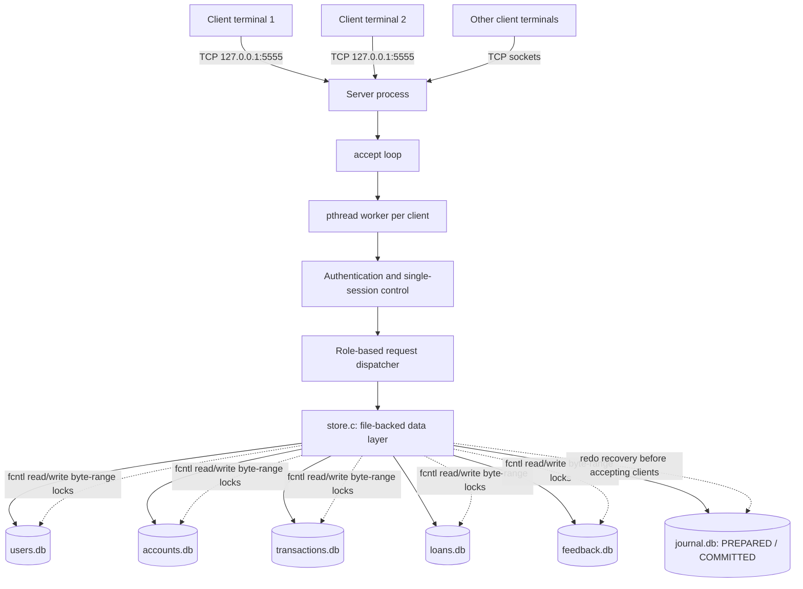

# Online Banking Management System (EG 301 Operating Systems Mini Project)

A C/POSIX client-server banking application for Arch Linux. It uses TCP sockets, one pthread worker per connected client, fixed-size text records in flat files, `fcntl()` byte-range locks, and PBKDF2 password hashing. No SQL database is required.

## 1. Features implemented

### Customer and joint account holder
- Login and logout with role verification.
- Only one active session per username at a time.
- View account details and balance.
- Deposit, withdraw, and transfer funds to an existing active account.
- Transaction history with operation, transaction amount, actor, timestamp, account numbers, current account balance, and a running balance after each transaction.
- Change password.
- Apply for loans and submit feedback.
- Joint account holders share the same account balance and transaction history.

### Employee
- Create customer users and accounts.
- Modify customer names.
- View loans assigned to that employee and approve/reject them.
- An approved loan is credited to the account and recorded in the transaction history.
- View transaction history for a specified account.

### Manager
- Activate/deactivate customer accounts, with a clear error if the account is already in the requested state.
- View pending and assigned loan applications.
- Assign a loan to an active employee.
- Review customer feedback.

### Administrator
- Add customer accounts and staff logins.
- Add a joint holder to an existing single-owner account (administrator-only by design).
- Soft-delete (deactivate) accounts so that historical transactions remain intact.
- Modify the primary account holder's name.
- Search for one account or list all accounts.
- Change account status and review loans/feedback.

### Validation and integrity
- A transfer checks that the destination exists and is active, that the source is active, and that sufficient funds are available. Zero or malformed amounts receive a specific validation message.
- Withdrawals cannot exceed the available balance.
- Balances and transaction amounts are stored as integer paise to avoid floating-point rounding.
- Every deposit, withdrawal, transfer, and loan approval uses an append-only write-ahead journal (`journal.db`). Its durable `PREPARED` record is written before account balances change; a durable `COMMITTED` marker is appended only after the related records are synced.
- Startup recovery replays every uncommitted prepared operation idempotently. Each transaction-history row includes the journal ID, so replay cannot append the same financial transaction twice. Loan approvals journal the account credit, transaction row, and loan decision as one recoverable operation.
- A storage failure after a durable `PREPARED` entry causes the server process to stop rather than continue serving potentially inconsistent state. Restart the server to replay the journal before it accepts clients.
- User passwords are salted and hashed with PBKDF2-HMAC-SHA-256 (120,000 iterations); plaintext passwords are not stored.
- Data files and their directory are created with restrictive permissions.

## 2. Architecture



- `client.c`: terminal UI and TCP client.
- `server.c`: TCP listener, per-client pthreads, login/session checks, and role authorization.
- `store.c`: all flat-file persistence, password hashing, record locking, and banking operations.
- `net.c`: newline-delimited TCP send/receive helpers.

The server binds to `127.0.0.1` by default, matching the project demo requirement to run server and clients on one machine.

Two diagrams are included in the project root: `architecture.png` / `architecture.svg` show the client-server deployment and journaled storage flow; `blueprint.png` / `blueprint.svg` show the C modules, record structures, and financial transaction invariant. The editable Graphviz source files (`architecture.dot` and `blueprint.dot`) are included as well.

## 3. Setup

Install GCC/Make and OpenSSL headers/libraries:

```bash
sudo pacman -S --needed base-devel openssl
```

Build both programs:

```bash
make
```

The build should finish without warnings on GCC. To remove generated binaries and object files:

```bash
make clean
```

## 4. Run the project

Terminal 1 — start the server:

```bash
./server 5555 ./data
```

Terminal 2 — start a client:

```bash
./client 127.0.0.1 5555
```

Run the client command in more terminals to test concurrent connections. The server accepts an optional port and data directory; use the same port in the client:

```bash
./server 6000 ./demo-data
./client 127.0.0.1 6000
```

Stop the server with `Ctrl+C`. The data remains in the selected directory between restarts.

### First-run staff credentials

When `users.db` is empty, the server creates these demo users and prints the credentials to its terminal:

| Role | Username | Initial password |
|---|---|---|
| Administrator | `admin` | `Admin@123` |
| Manager | `manager` | `Manager@123` |
| Employee | `employee` | `Employee@123` |

Change these passwords after logging in. Customer accounts can be created from the client start menu. Joint holders are added by an administrator from the admin menu.

To reset the demo data, stop the server first and remove only the demo data directory, for example:

```bash
rm -rf ./data
```

**Warning:** the command above permanently deletes the records in `./data`; change the path if your data directory is different.

## 5. Flat-file record schemas

Each database is a text file. Every record occupies exactly 1024 bytes: pipe-separated text fields, space padding, and a newline at the end. Fixed-size records make each record's byte offset deterministic, so `fcntl()` can lock the selected record range without rewriting the rest of the file. Do not edit these files while the server is running.

| File | Fields, in order |
|---|---|
| `users.db` | `id | username | salt_hex | password_hash_hex | role | active | full_name | account_id` |
| `accounts.db` | `id | owner1_username | owner2_username | balance_paise | active | account_type` |
| `transactions.db` | `id | from_account | to_account | operation | amount_paise | actor | timestamp | details | journal_id` (`journal_id=0` for legacy rows) |
| `journal.db` | Append-only `PREPARED` and `COMMITTED` records with intended post-balances, transaction metadata, and optional loan-approval fields |
| `loans.db` | `id | account_id | applicant | amount_paise | status | assigned_employee | created_at | reviewed_by | note` |
| `feedback.db` | `id | username | message | timestamp` |

For deposits and approved loan credits, the transaction's `to_account` is the credited account and `from_account` is `0`. For withdrawals, `from_account` is the debited account and `to_account` is `0`. Transfers have both account numbers.

### Crash recovery and ACID-oriented transaction flow

1. The server takes an in-process financial mutex and an exclusive `fcntl` lock on `journal.db`, then runs any pending recovery before starting a new financial operation.
2. While the affected account record(s) are write-locked, it validates the operation and appends a `PREPARED` journal record. `fdatasync(journal.db)` must succeed before any account balance is changed.
3. It applies the recorded post-balances, appends the transaction row carrying the journal ID, and—when approving a loan—updates the loan status. Each affected file is synced before proceeding.
4. It appends and syncs a `COMMITTED` journal record. Journal state transitions are append-only, so a torn trailing record can be truncated without losing the preceding `PREPARED` record.
5. On startup, before listening for clients, the server replays every prepared operation without a committed marker. Account balances are set to their intended post-values (not incremented a second time), the transaction row is inserted only if that journal ID is absent, and the loan status is set to approved idempotently.

This is redo-based recovery: once a durable `PREPARED` record exists, recovery completes the operation rather than trying to guess whether the client saw a success reply. If a crash happens after the prepare record, the transaction may complete on restart even if the client did not receive its response; check the resulting balance/history before retrying a request.

The journal protects the financial paths (deposit, withdrawal, transfer, loan approval). Other administrative metadata edits and loan rejection/assignment are individually synced, but are not multi-record journal transactions. This remains a teaching project and not a production banking ledger.

## 6. Operating Systems concepts demonstrated

- **Process and IPC:** client and server are separate processes communicating over TCP sockets (`socket`, `bind`, `listen`, `accept`, `connect`, `send`, `recv`).
- **Multithreading:** the server creates a detached pthread for every client connection, allowing multiple clients to use the service concurrently.
- **File management system calls:** persistent records are accessed with `open`, `pread`, `pwrite`, `fstat`, `fdatasync`, `close`, and `mkdir`, not `fopen`/`fprintf` for database access.
- **File locking:** `fcntl` uses `F_RDLCK` for record reads and `F_WRLCK` for updates. Append operations lock the file range. Account balance updates and transfers lock the relevant account records.
- **Thread safety:** per-file pthread mutexes protect same-process operations. This is important because traditional POSIX `fcntl` record locks are process-associated; they are not a substitute for pthread synchronization between threads in the same process.
- **Critical sections:** a financial mutex serializes financial transactions among server threads, the journal's whole-file `fcntl` write lock coordinates use of the journal across processes, and account records use stable-order write locks. Write-ahead redo recovery repairs interrupted balance/history/loan updates before the server accepts clients.
- **Authentication:** salted password hashing, role checks, and an in-memory active-session registry reject a second simultaneous login for the same username.

## 7. Automated concurrency and crash-recovery tests

Build and run the focused test suite:

```bash
make test
```

The test target creates and removes its own temporary data directory. It runs 200 concurrent transfers in four pthreads and 50 transfers across two processes, and confirms the total balance is conserved. It injects process crashes after the journal `PREPARED` record, after the first transfer-account write, after both transfer-account writes, after a loan transaction row but before its loan-status update, and after the loan status is updated but before `COMMITTED`. Restart recovery must preserve intended balances, restore loan status, create exactly one transaction-history row, and reject a retry of an already-approved loan. It repeats recovery to check idempotence and verifies that an incomplete trailing journal row is repaired.

For a manual demonstration only, stop the normal server and use a disposable data directory. For example:

```bash
BANK_FAILPOINT=after_account1 ./server 5555 ./wal-demo-data
```

Perform a transfer from a client. The server will deliberately exit at the named point. Restart with the failpoint disabled so it can recover before accepting clients:

```bash
env -u BANK_FAILPOINT ./server 5555 ./wal-demo-data
```

Supported failpoints are `after_prepare`, `after_account1`, `after_account2`, `after_transaction`, and `after_loan`. Do not enable them against data you need for normal use.

## 8. Suggested demonstration flow

1. Start the server and log in as `admin`.
2. Add a customer account and note its account number; repeat for a second customer.
3. Log in as the first customer, deposit money, and transfer a portion to the second account.
4. Log in as the second customer and verify the balance and transaction history.
5. As admin, add a joint holder to the first account. Log in through the **Joint account holder** role and verify the shared balance.
6. As the customer, apply for a loan. As `manager`, assign the loan to `employee`. As `employee`, approve the loan and verify that the approved amount appears in the account balance and history.
7. As manager, deactivate the account. Verify that the account holder cannot perform banking actions until it is reactivated.
8. Try logging into the same username from two client terminals; the second login should be rejected until the first session logs out or disconnects.

## 9. Scope and security note

This is an educational mini project, not production banking software. It binds to localhost and does not encrypt traffic with TLS. For the course demo, use it on your own machine and keep the data directory private. Only one server instance should use a particular data directory at a time because the active-session list is maintained in server memory.
